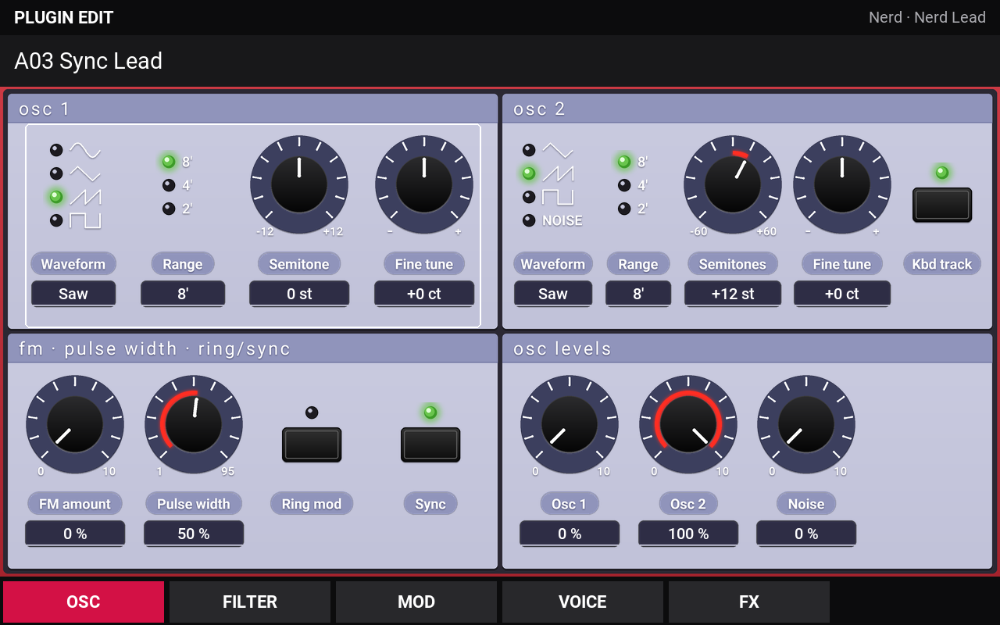
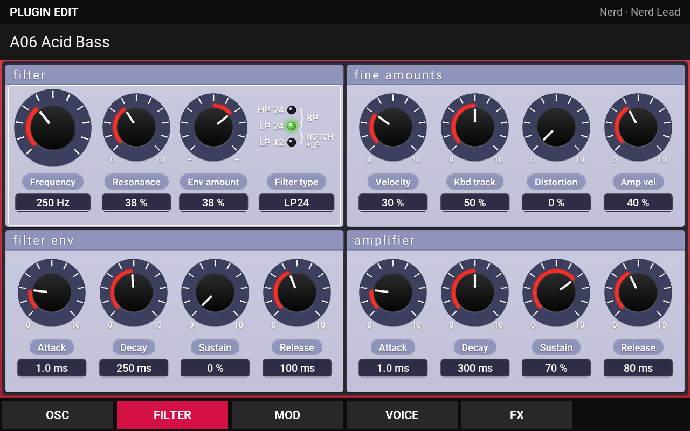
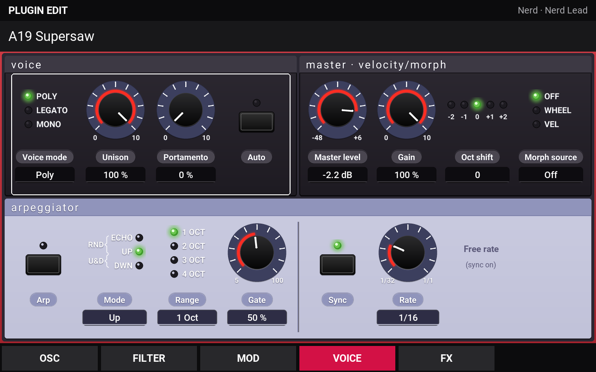
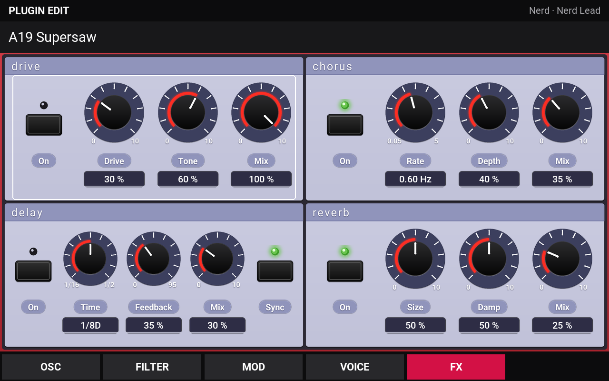

# Nerd Lead for the Akai MPC

A free virtual analog synth plugin for the Akai MPC (standalone, MPC OS 3.10.1 or later): two oscillators with FM, sync
and ring, a multimode filter, three envelopes, two LFOs, morph, unison, an arpeggiator that follows the MPC's transport,
and drive, chorus, delay and reverb, with 99 presets. It runs on the MPC itself, no computer needed.

**Download:** [Releases](https://github.com/jconde007/nerd-lead-mpc/releases) → `nerd-lead-mpc-1.2.1.zip`

The same synth is also on the M-VAVE FM-1 as [Nerd Pocket](https://github.com/jconde007/nerd-pocket).

## Install
1. Unzip and copy the whole folder **`Nerd - VST - Nerd Lead`** into a folder named **`VST2 Plugins`** at the top level
   of a USB drive, an SD card or the MPC's internal drive (create `VST2 Plugins` if it isn't there). Keep the folder
   name as it is.
2. The MPC needs **MPC OS 3.10.1 or later**. Turn on **Preferences → Enhancements (Beta) → Enable Enhancements** and
   **External Plugin Support**.
3. Make a plugin program and pick **Nerd → Nerd Lead**.
4. To update: remove the plugin from the track, replace the folder, and add it again.

`INSTALL.txt` in the zip has the details.

## The synth
- **Oscillators:** osc 1 saw, pulse, triangle or sine; osc 2 saw, pulse, triangle or noise; range 8'/4'/2', semitones,
  fine tune, pulse width, FM, sync, ring, osc 2 keyboard tracking.
- **Filter:** LP 12, LP 24, HP, BP and Notch, with resonance, envelope amount, velocity, keyboard tracking and
  distortion.
- **Envelopes and LFOs:** filter and amp ADSR, a mod envelope, LFO 1 and LFO 2.
- **Voices:** 8 notes with a CPU guard, poly / mono / legato, unison, portamento with Auto, sustain pedal.
- **Morph:** the mod wheel or velocity moves the knobs that each preset sets up for it.
- **Arpeggiator:** up, down, up/down, random and echo, 1-4 octaves; with Sync on it follows the MPC's transport.
- **Effects:** drive, chorus, delay (synced to the MPC's tempo or free) and reverb.
- **MIDI:** notes with velocity, pitch bend, mod wheel, sustain, Program Change (0-98), and a CC for every knob.

## The screen
Five pages, each with four modules; each module is a bank of four Q-Links, and touching a control jumps to its bank.

| Page | Modules |
| --- | --- |
| OSC | osc 1 · osc 2 · FM, pulse width, ring, sync · osc levels |
| FILTER | filter · fine amounts · filter envelope · amplifier |
| MOD | LFO 1 · LFO 2 · mod envelope |
| VOICE | voice · master · arpeggiator |
| FX | drive · chorus · delay · reverb |

(The pictures are previews made on a computer from the plugin's screen files.)

## Good to know
- Third-party plugins are not supported by inMusic / Akai. Save your work often, and test before you rely on it live.
- Tested on one MPC One. The CPU guard lets it use up to half of each audio block; heavy presets may play 6-7 notes
  instead of 8.
- Morph amounts come with each preset and can't be edited on the MPC.
- Changing program cuts the notes that are sounding. No aftertouch or MIDI clock (it follows the MPC's transport).

## CC map
| | CC |
| --- | --- |
| Osc | 30 Osc 1 wave · 31 Osc 2 wave · 78 Osc 2 semi · 33 Osc 2 fine · 34 Osc 2 kbd track · 70 FM · 79 PW · 35 Sync · 109 Ring · 115 Osc 1 range · 116 Osc 1 semi · 117 Osc 1 fine · 118 Osc 2 range |
| Mix | 8 Mix (Osc 1 ↔ Osc 2) · 110 Osc 1 level · 111 Osc 2 level · 112 Noise |
| Filter | 74 Cutoff · 42 Resonance · 43 Env amount · 44 Type · 45 Velocity · 46 Kbd track · 80 Distortion |
| Envelopes | 38 39 40 41 Filter A D S R · 73 36 37 72 Amp A D S R · 113 Amp gain · 114 Amp velocity |
| LFO | 19 LFO 1 rate · 20 wave · 21 dest · 22 amount · 23 LFO 2 rate · 24 dest · 25 amount |
| Mod env | 26 Attack · 27 Decay · 28 Destination · 29 Amount |
| Voice | 5 Glide · 65 Glide auto · 15 Voice mode · 16 Unison · 17 Octave · 119 Morph source |
| Arp | 102 On · 103 Mode · 104 Rate · 105 Gate · 106 Range · 107 Sync · 108 Free Hz |

## Licence
Nerd Lead is © 2026 Jorge Conde: free to use and to share unchanged (the zip as it is). It is not open source. Built
with inMusic's MPC Plugin Builder SDK (MIT; its notice is in the zip, `LICENSES/`).

"MPC" and "Akai Professional" are trademarks of inMusic Brands, Inc. Nerd Lead is not affiliated with or endorsed by
inMusic.
